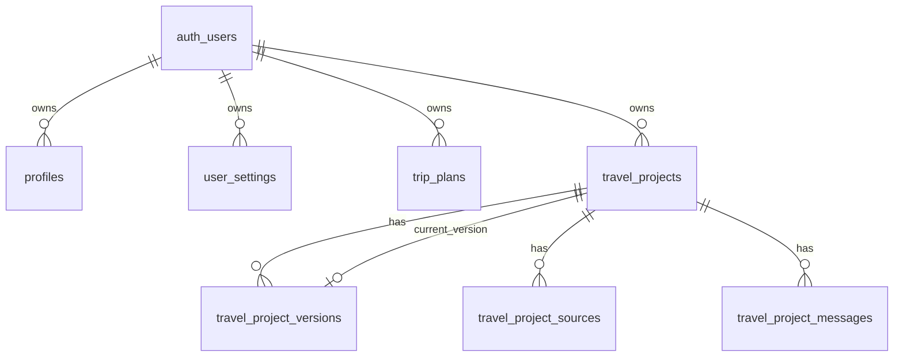

# Wanderly v1.9 Phase 1 Database Design

## 1. 当前数据库审计

### 1.1 当前 Supabase migration 列表

- `001_init_v1_6_auth_trips.sql`
- `002_explore_trip_contents.sql`
- `003_explore_trip_contents_phase1_3.sql`
- `004_explore_trip_contents_grants.sql`
- `005_user_settings.sql`
- `006_trip_plans_metadata.sql`

### 1.2 当前与旅行相关的数据库结构

当前真正承载用户旅行数据的云端表只有一张主表：

- `public.trip_plans`

与旅行产品相关但不直接保存用户旅行计划的表有：

- `public.user_settings`
- `public.profiles`
- `public.explore_trip_contents`

### 1.3 现有表结构审计

#### `public.profiles`

用途：

- 用户基础资料。

主键：

- `id uuid primary key`

外键：

- `id -> auth.users.id (on delete cascade)`

字段：

- `id uuid not null`
- `email text null`
- `display_name text null`
- `avatar_url text null`
- `created_at timestamptz not null default now()`
- `updated_at timestamptz not null default now()`

关系：

- 与旅行计划没有直接外键关系。
- 作为用户身份附属表存在。

#### `public.trip_plans`

用途：

- 当前唯一的用户旅行计划云端持久化表。
- 同时承担“旅行身份”、“旅行内容快照”、“保存状态”、“来源 metadata”。

主键：

- `id uuid primary key default gen_random_uuid()`

外键：

- `user_id -> auth.users.id (on delete cascade)`

字段：

- `id uuid not null`
- `user_id uuid not null`
- `title text not null`
- `destination_city text null`
- `start_date date null`
- `end_date date null`
- `days integer null`
- `budget numeric null`
- `trip_request_json jsonb not null`
- `trip_plan_json jsonb not null`
- `enrichment_json jsonb null`
- `weather_summary_json jsonb null`
- `cover_image_url text null`
- `source_type text not null default 'ai_generated'`
- `status text not null default 'saved'`
- `trip_preferences_json jsonb not null default '{}'::jsonb`
- `local_draft_id text null`
- `last_opened_at timestamptz null`
- `created_at timestamptz not null default now()`
- `updated_at timestamptz not null default now()`

约束：

- `trip_plans_days_positive`: `days is null or days > 0`
- `trip_plans_budget_non_negative`: `budget is null or budget >= 0`
- `trip_plans_source_type_check`: `source_type in ('ai_generated', 'blank_manual', 'explore_import')`
- `trip_plans_status_check`: `status in ('draft', 'saved', 'archived')`

索引：

- `trip_plans_user_id_idx (user_id)`
- `trip_plans_updated_at_desc_idx (updated_at desc)`
- `trip_plans_destination_city_idx (destination_city)`
- `trip_plans_start_date_idx (start_date)`
- `trip_plans_user_id_status_idx (user_id, status)`
- `trip_plans_user_id_last_opened_at_desc_idx (user_id, last_opened_at desc nulls last)`

现状判断：

- `trip_plans` 是一个“单表承载一切”的结构。
- 它既保存 Trip 内容，又承担类似 Project 的身份作用。
- 它不支持多版本。
- 它不支持项目级 AI conversation。
- 它不支持一对多来源记录。

#### `public.user_settings`

用途：

- 保存用户偏好，不保存具体旅行计划。
- 未来可承接 AI Preference Layer。

主键：

- `id uuid primary key default gen_random_uuid()`

外键：

- `user_id -> auth.users.id (on delete cascade)`

唯一约束：

- `user_id unique`

字段：

- `id uuid not null`
- `user_id uuid not null unique`
- `travel_preferences_json jsonb not null`
- `workspace_preferences_json jsonb not null`
- `ai_preferences_json jsonb not null`
- `created_at timestamptz not null default now()`
- `updated_at timestamptz not null default now()`

索引：

- `user_settings_user_id_idx (user_id)`

现状判断：

- 这张表已经适合作为未来 `AI behavior preference` 的上游。
- 但它不承载任何项目或版本关系。

#### `public.explore_trip_contents`

用途：

- Explore 内容库。
- 是公开可读的旅行内容来源层，不是用户自己的项目表。

主键：

- `id uuid primary key default gen_random_uuid()`

外键：

- 无用户外键。

关键字段：

- `id uuid not null`
- `external_id text not null`
- `slug text not null unique`
- `title text not null`
- `summary text not null`
- `city text not null`
- `city_code text not null`
- `region text null`
- `trip_type text not null`
- `theme text null`
- `days integer not null`
- `tags text[] not null`
- `pace text null`
- `budget_level text null`
- `budget_note text null`
- `status text not null`
- `review_status text not null`
- `highlights_json jsonb not null`
- `itinerary_days_json jsonb not null`
- `poi_highlights_json jsonb not null`
- `food_highlights_json jsonb not null`
- `raw_content_json jsonb not null`
- `published_at timestamptz null`
- `created_at timestamptz not null`
- `updated_at timestamptz not null`

现状判断：

- `explore_trip_contents` 适合作为 `travel_project_sources` 的上游素材来源。
- 但不应直接替代用户项目数据。

### 1.4 当前 API / 数据流与数据库的关系

当前 `/api/trips` 与 `/api/trips/[tripId]` 都只读写 `trip_plans`。

现有流程：

1. 前端本地维护 `TripRequest`、`TripPlan`、workspace session。
2. 用户点击保存时，`lib/trips/save-payload.ts` 把当前 `TripRequest + TripPlan` 映射为 `trip_plans` row。
3. 保存后 `My Trips` 列表直接读取 `trip_plans`。
4. 打开历史行程时，再把 `trip_plans.trip_request_json` 和 `trip_plans.trip_plan_json` 恢复到 localStorage。

结论：

- 当前数据库没有 Project 层。
- 当前数据库没有 Version 层。
- 当前数据库没有 Message 层。
- 当前数据库没有 Source 记录层。

## 2. Phase 1 新 Schema 设计

Phase 1 目标不是替换 `trip_plans`，而是在其旁边建立新的 `TravelProject` 数据底座。

核心原则：

- `TravelProject` 负责 identity 和 lifecycle。
- `TravelProjectVersion` 负责内容快照。
- `TravelProjectSource` 负责来源记录。
- `TravelProjectMessage` 负责轻量 AI 上下文。
- `TripPlan` 继续作为 Workspace render contract。

### 2.1 `travel_projects`

用途：

- 旅行项目身份层。
- 表示“这是一趟什么旅行项目”，而不是“完整旅行内容本身”。

建议字段：

| 字段名 | 类型 | 必须 | 默认值 | 作用 |
| --- | --- | --- | --- | --- |
| `id` | `uuid` | 是 | `gen_random_uuid()` | 项目标识 |
| `user_id` | `uuid` | 是 | 无 | 项目归属用户 |
| `title` | `text` | 是 | 无 | 项目显示标题 |
| `lifecycle_state` | `text` | 是 | `'new'` | 项目生命周期状态 |
| `current_flow_stage` | `text` | 否 | `null` | 当前 AI Flow 阶段 |
| `current_version_id` | `uuid` | 否 | `null` | 当前激活版本 |
| `last_activity_at` | `timestamptz` | 是 | `now()` | 最近活动时间 |
| `created_at` | `timestamptz` | 是 | `now()` | 创建时间 |
| `updated_at` | `timestamptz` | 是 | `now()` | 更新时间 |

建议枚举：

- `lifecycle_state`
  - `new`
  - `exploring`
  - `planning`
  - `proposed`
  - `generating`
  - `workspace`
  - `editing`
  - `archived`

- `current_flow_stage`
  - `source_received`
  - `source_review`
  - `clarifying`
  - `proposal_ready`
  - `proposal_adjusting`
  - `generating`
  - `workspace_ready`
  - `abandoned`

设计理由：

- 不把 `destination_city`、`start_date`、`end_date`、`days` 放在 `travel_projects` 主表。
- 这些字段属于 trip content 或 planning request，不属于 project identity。
- 这样 `TravelProject` 可以覆盖“还没定去哪”“还没生成版本”“只有输入来源”的早期状态。

### 2.2 `travel_project_versions`

用途：

- 保存项目下的稳定版本。
- 保存被用户接受的 `TripPlan snapshot`。

建议字段：

| 字段名 | 类型 | 必须 | 默认值 | 作用 |
| --- | --- | --- | --- | --- |
| `id` | `uuid` | 是 | `gen_random_uuid()` | 版本标识 |
| `project_id` | `uuid` | 是 | 无 | 所属项目 |
| `version_number` | `integer` | 是 | 无 | 项目内递增版本号 |
| `version_status` | `text` | 是 | `'accepted'` | 版本状态 |
| `created_from` | `text` | 否 | `null` | 版本产生原因 |
| `trip_plan_json` | `jsonb` | 是 | 无 | `TripPlan` 快照 |
| `trip_request_snapshot_json` | `jsonb` | 否 | `null` | 版本对应的请求快照 |
| `proposal_summary_json` | `jsonb` | 否 | `null` | 可选提案摘要，占位未来 proposal 恢复 |
| `created_by` | `text` | 否 | `null` | 可选，记录 `user` / `assistant` |
| `created_at` | `timestamptz` | 是 | `now()` | 创建时间 |
| `updated_at` | `timestamptz` | 是 | `now()` | 更新时间 |

建议枚举：

- `version_status`
  - `draft`
  - `proposed`
  - `accepted`

- `created_from`
  - `ai_generate`
  - `ai_adjust`
  - `manual_edit`
  - `template_import`
  - `import_transform`

版本编号建议：

- `version_number` 在每个 `project_id` 下递增。
- 需要唯一约束：`(project_id, version_number) unique`

TripPlan snapshot 存储建议：

- v1.9 推荐直接用 `trip_plan_json jsonb` 存储完整 `TripPlan`
- 继续沿用现有 render contract，避免在 Phase 1 改 Workspace 渲染层

说明：

- `draft` / `proposed` 可用于将来承载提案持久化。
- 但 v1.9 核心只要求至少支持 `accepted` 版本。
- `proposal_summary_json` 不是必须字段，如果想极简，可以延期；但如果要支持 proposal 刷新恢复，它是一个可接受的轻量预留。

### 2.3 `travel_project_sources`

用途：

- 保存项目来源。
- 支持多个来源进入同一项目。

建议字段：

| 字段名 | 类型 | 必须 | 默认值 | 作用 |
| --- | --- | --- | --- | --- |
| `id` | `uuid` | 是 | `gen_random_uuid()` | 来源记录标识 |
| `project_id` | `uuid` | 是 | 无 | 所属项目 |
| `source_type` | `text` | 是 | 无 | 来源类型 |
| `source_title` | `text` | 否 | `null` | 来源展示标题 |
| `source_payload_json` | `jsonb` | 否 | `'{}'::jsonb` | 原始来源 payload |
| `created_at` | `timestamptz` | 是 | `now()` | 创建时间 |
| `updated_at` | `timestamptz` | 是 | `now()` | 更新时间 |

建议枚举：

- `source_type`
  - `blank_input`
  - `explore_archive`
  - `import_text`
  - `uploaded_file`
  - `existing_trip`

source payload 保存建议：

- `blank_input`
  - 保存原始自然语言输入、初始解析结果、用户补充字段

- `explore_archive`
  - 保存 `explore_trip_contents.id`
  - 保存 `slug`
  - 保存当时被选中的标题摘要

- `import_text`
  - 保存用户粘贴文本原文
  - 保存结构化解析摘要

- `uploaded_file`
  - 未来保存文件元信息、抽取文本、文件类型

- `existing_trip`
  - 保存来源 trip id / project id / version id 引用

设计理由：

- 不能把来源字段塞回 `travel_projects` 主表。
- 项目后续可能叠加多个输入来源，例如先选 Explore，再粘贴补充攻略。

### 2.4 `travel_project_messages`

用途：

- 保存项目级轻量 AI 上下文。
- 只支持恢复最基本的 project conversation。

建议字段：

| 字段名 | 类型 | 必须 | 默认值 | 作用 |
| --- | --- | --- | --- | --- |
| `id` | `uuid` | 是 | `gen_random_uuid()` | 消息标识 |
| `project_id` | `uuid` | 是 | 无 | 所属项目 |
| `role` | `text` | 是 | 无 | `system` / `user` / `assistant` |
| `content` | `text` | 是 | 无 | 消息正文 |
| `created_at` | `timestamptz` | 是 | `now()` | 创建时间 |

v1.9 明确边界：

- 不做 message threading
- 不做 tool call log
- 不做 message metadata graph
- 不做 attachment system

只要求：

- 能恢复最近的共创上下文
- 能解释“为什么生成了这个版本”
- 为后续 Workspace AI 入口提供最小底座

## 3. ER 关系说明

关系说明：

- 一个用户可以有多个 `travel_projects`
- 一个项目可以有多个 `travel_project_versions`
- 一个项目可以有多个 `travel_project_sources`
- 一个项目可以有多条 `travel_project_messages`
- `travel_projects.current_version_id` 指向当前激活版本

与旧表关系：

- `trip_plans` 与 `travel_projects` 在 Phase 1 期间并行存在
- 不建议在第一步就给 `trip_plans` 强加外键到 `travel_projects`
- 推荐等 API 接入稳定后，再决定是否需要弱关联字段或映射表

## 4. 字段设计边界

### 4.1 哪些字段属于 Project identity

应放在 `travel_projects`：

- `id`
- `user_id`
- `title`
- `lifecycle_state`
- `current_flow_stage`
- `current_version_id`
- `last_activity_at`
- `created_at`
- `updated_at`

### 4.2 哪些字段属于 Trip content / Request data

不应放在 `travel_projects`：

- `destination_city`
- `start_date`
- `end_date`
- `days`
- `budget`
- `interests`
- `travelStyles`
- `mustVisitPlaces`
- `avoidPlaces`
- `trip request detail`
- `TripPlan full snapshot`

这些字段更适合放在：

- `travel_project_versions.trip_plan_json`
- `travel_project_versions.trip_request_snapshot_json`
- `travel_project_sources.source_payload_json`

这样可以确保：

- 项目在“尚未成形”阶段也能存在
- 多版本可以各自持有不同 trip content
- 来源记录和版本内容不会互相污染

## 5. 旧数据兼容策略

### 5.1 新用户是否直接创建 TravelProject

推荐答案：

- 是，但只在新 Copilot Flow 中直接创建 `TravelProject`
- 旧 `/create` -> `/plan` -> `/workspace` 保存 `trip_plans` 的流程继续保留

原因：

- Phase 1 的目标是建立底座，不是一次性替换旧系统
- 新 flow 可以率先使用 `TravelProject`
- 旧 flow 继续用 `trip_plans`，降低回归风险

### 5.2 老 `trip_plans` 是否迁移

推荐答案：

- Phase 1 不做全量迁移
- 旧 `trip_plans` 继续作为历史已保存旅行数据保留

原因：

- 现有 `trip_plans` 是稳定线上数据
- 当前没有版本历史和来源记录，强行回填成 `travel_projects` 只能做不完整映射
- 先保持可读可打开，比早期大迁移更安全

### 5.3 Workspace 如何同时支持旧数据和新数据

推荐方案：

- Workspace 继续吃 `TripPlan`
- 新项目流：
  - 从 `travel_project_versions.trip_plan_json` 读取 `TripPlan`
- 旧历史流：
  - 从 `trip_plans.trip_plan_json` 读取 `TripPlan`

结论：

- Workspace 层可以做“双来源单契约”
- 即数据来源不同，但进入 Workspace 的 render contract 仍是同一个 `TripPlan`

### 5.4 是否需要 migration script

推荐答案：

- 需要数据库 migration，但不是“旧数据搬迁脚本优先”
- Phase 1 首先需要的是建新表 migration
- 老数据批量 backfill script 可以作为后续可选步骤

更具体地说：

- 必需：
  - 创建 `travel_projects`
  - 创建 `travel_project_versions`
  - 创建 `travel_project_sources`
  - 创建 `travel_project_messages`
  - 创建索引、RLS、触发器、外键

- 可延期：
  - 把老 `trip_plans` 批量回填成 `travel_projects`
  - 为所有旧记录生成 source / version / message

## 6. 推荐 Migration 顺序

推荐顺序：

### Step A：创建基础表

- 创建 `travel_projects`
- 创建 `travel_project_versions`
- 创建 `travel_project_sources`
- 创建 `travel_project_messages`
- 创建 `updated_at` trigger

目标：

- 先把新数据底座独立落下

### Step B：创建关系与约束

- `travel_projects.user_id -> auth.users.id`
- `travel_project_versions.project_id -> travel_projects.id`
- `travel_project_sources.project_id -> travel_projects.id`
- `travel_project_messages.project_id -> travel_projects.id`
- `travel_projects.current_version_id -> travel_project_versions.id`
- 增加枚举 check constraint
- 增加 `(project_id, version_number)` unique

目标：

- 保证版本序号、生命周期、来源类型的合法性

### Step C：创建索引

建议索引：

- `travel_projects(user_id, lifecycle_state)`
- `travel_projects(user_id, last_activity_at desc)`
- `travel_project_versions(project_id, version_number desc)`
- `travel_project_sources(project_id, created_at desc)`
- `travel_project_messages(project_id, created_at asc)`

目标：

- 支撑 My Trips、版本加载、项目消息恢复

### Step D：补充 RLS 与 own policies

每张表都应遵循当前 `trip_plans` 模式：

- `select own`
- `insert own`
- `update own`
- `delete own`

目标：

- 保持当前用户隔离模型一致

### Step E：新增项目级 API

新增而不是替换：

- `POST /api/projects`
- `GET /api/projects`
- `GET /api/projects/[projectId]`
- `POST /api/projects/[projectId]/versions`
- `POST /api/projects/[projectId]/messages`

目标：

- 让新 Copilot Flow 优先走新表

### Step F：逐步接入旧流程

推荐接入顺序：

1. 新 AI Flow 创建 `travel_projects`
2. proposal / generate 阶段写入 `travel_project_versions`
3. Workspace 支持从 `travel_project_versions` 加载 `TripPlan`
4. My Trips 从 `trip_plans` 逐步切到 `travel_projects`

目标：

- 先新后旧，逐步迁移，不一次切断

## 7. 风险点

### 7.1 双写或双源复杂度

风险：

- 短期内 `trip_plans` 和 `travel_projects` 并存，容易让开发者混淆“哪个才是主数据源”

建议：

- 明确规则：
  - 新 Copilot 项目主数据源是 `travel_projects`
  - 旧保存旅行仍是 `trip_plans`
  - Workspace 只认 `TripPlan`

### 7.2 旧数据不完整

风险：

- 老 `trip_plans` 没有 message、version、source 历史

建议：

- 不强行补齐历史
- 如果后续需要接入新 Project 体系，使用“按需惰性转换”优于“一次性全量迁移”

### 7.3 当前版本指针一致性

风险：

- `travel_projects.current_version_id` 和 `travel_project_versions.project_id` 之间可能出现不一致

建议：

- 在 API service 层统一处理“创建版本并更新 current_version_id”的事务逻辑

### 7.4 Proposal 持久化边界不清

风险：

- 如果 `proposal_ready` 阶段没有落库，用户刷新会丢内容

建议：

- v1.9 最迟在接入新 AI Flow 时明确 proposal 持久化方案
- 推荐优先使用 `travel_project_versions.version_status = 'proposed'`

### 7.5 My Trips 迁移时的数据混排

风险：

- 一部分列表项来自 `trip_plans`
- 一部分来自 `travel_projects`
- 容易出现排序、状态、来源文案不一致

建议：

- 在 My Trips 切换前，先设计统一的 list item view model

## 8. 结论

Phase 1 的正确方向不是重做 `trip_plans`，而是在其旁边建立新的项目底座：

- `travel_projects` 负责身份
- `travel_project_versions` 负责版本
- `travel_project_sources` 负责来源
- `travel_project_messages` 负责轻量 AI 上下文

同时保持：

- 现有 `trip_plans` 流程继续可用
- Workspace 继续以 `TripPlan` 为单一渲染契约
- 旧数据不强制迁移，优先新流量接入新表

这是对 v1.9 风险最低、后续扩展性最高的数据库演进方式。
