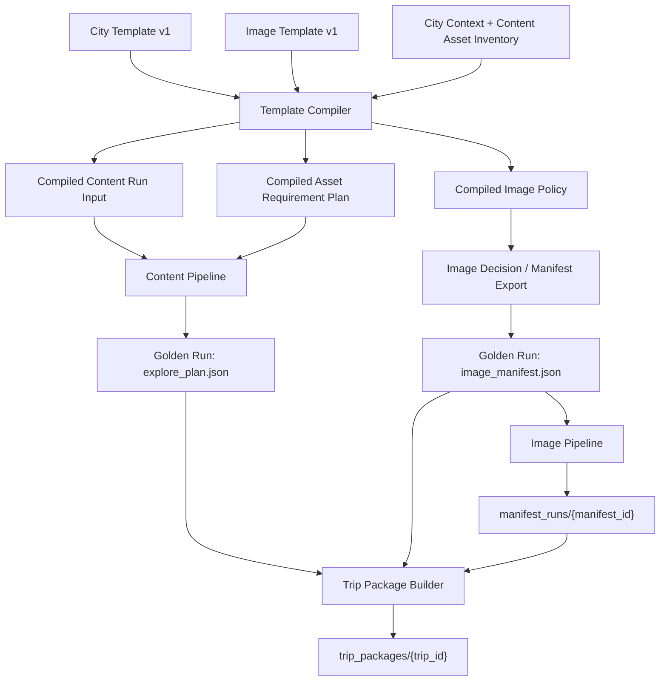

# V3.5 Template Pipeline Integration Design

Status: design only  
Step: V3.5 Step1-E3-H3.5.5-A  
Scope: City Template v1 / Image Template v1 integration design

This document designs how the template system should connect to the existing Wanderly Content Pipeline, Image Pipeline, and Trip Package Builder without changing the current pipeline contracts.

## Goals

1. Treat City Template v1 and Image Template v1 as upstream authoring contracts.
2. Compile templates into the input shapes already accepted by the Content Pipeline and Image Pipeline.
3. Preserve the current join key: `asset_instance_id`.
4. Keep `ExplorePlan`, Image Manifest v1.1, Image Asset, and Trip Package v1 schemas unchanged.
5. Make the next implementation step small enough to test with one city before expanding to 10 cities.

## Current Pipeline Audit

### Content Pipeline Input

The general generation entry is `travel-content-pipeline/src/run.ts`.

It currently reads:

- `input/request.json`

and writes:

- `output/plan.json`

The request is parsed as `GenerateRequest`:

```ts
{
  city: string;
  days: number;
  trip_type: "family" | "couple" | "student" | "solo";
  budget: "low" | "medium" | "high";
  theme?: string;
  preferences: PreferenceTag[];
  pace: "slow" | "balanced" | "dense";
}
```

Golden Sample generation currently uses a richer test harness in `travel-content-pipeline/src/testGenerateGoldenSamplesWithAssets.ts`. That harness defines `GenerationCase` with:

- `id`
- `goldenRunId`
- `fileName`
- `request`
- `contentAssetRequest`
- `preferences`
- `focusRules`
- `requiredAssetIds`

The Golden Run output has already been normalized to:

```text
travel-content-pipeline/output/golden_runs/{trip_id}/
  explore_plan.json
  image_manifest.json
  generation_report.json
```

### Image Manifest Generation

The Image Manifest is exported from `travel-content-pipeline/src/contentAsset/exportImageManifest.ts`.

Current flow:

```text
RequestContext
  -> buildGenerationContextWithAssets()
  -> load city assets
  -> rankAssets()
  -> selectCandidates()
  -> buildContentAssetContext()
  -> exportImageManifest()
  -> image_manifest.json
```

Each selected content asset contains an `image_context.images[]` list built by `imageDecision.ts`.

`exportImageManifest()` maps each image requirement through `buildImageManifestTask()`, producing:

- `asset_instance_id`
- `asset_id`
- `asset_name`
- `image_slot`
- `type`
- `source_preference`
- `generation_mode`
- `decision_reason`
- `prompt`
- `location_context`
- `search_keywords`
- `visual_subject`
- `image_usage_profile`
- `review_requirement`
- `status`

Current hard contract:

```text
asset_instance_id = {asset_id}_{image_slot}
```

This should remain the universal content-image join key.

### Image Decision Interface

Current decision layer is `travel-content-pipeline/src/contentAsset/imageDecision.ts`.

It receives:

- `ContentAsset`
- `family`

and returns:

- `ImageContextV2`

Decision inputs currently considered:

- asset family
- inferred `ImageRequirementType`
- inferred `image_slot`
- derived `image_usage_profile`

Decision outputs:

- `image_slot`
- `source_preference`
- `generation_mode`
- `decision_reason`
- `confidence`
- `prompt`

Current strategy behavior:

- `food` -> `real_photo`
- `place` -> `real_photo`
- `experience` -> `hybrid`
- concrete place-entry `cover` -> `hybrid`
- city mood cover fallback -> `ai_generated`

The current interface does not accept templates directly. Template integration should therefore happen before this layer, either by selecting/ranking assets with template-derived rules or by passing optional template hints into a future decision adapter.

### Image Pipeline Input

The Image Pipeline entry is `image-pipeline/image-pipeline/src/pipeline/run_manifest_pipeline.js`.

It reads an upstream image manifest, normalizes it, builds asset tasks, executes each task, and writes:

```text
output/manifest_runs/{manifest_id}/
  image_manifest.input.json
  asset_tasks.json
  pipeline_summary.json
  assets/
    {asset_instance_id}.image_asset.json
```

The normalizer supports upstream manifests with `images[]` and preserves important metadata:

- `city`
- `asset_name`
- `upstream_status`
- `location_context`
- `search_keywords`
- `image_usage_profile`
- `visual_subject`

Generation mode normalization:

- `real_first` -> `real_photo`
- `mixed` -> `hybrid`
- `real_photo` -> `real_photo`
- `ai_generated` -> `ai_generated`
- `hybrid` -> `hybrid`

### Trip Package Builder Input

The Trip Package Builder is `scripts/build_trip_package.js`.

It expects:

```text
travel-content-pipeline/output/golden_runs/{trip_id}/
  explore_plan.json
  image_manifest.json
  generation_report.json

output/manifest_runs/{manifest_id}/
  pipeline_summary.json
  assets/*.image_asset.json
```

and writes:

```text
trip_packages/{trip_id}/
  package_manifest.json
  content/
    explore_plan.json
    image_manifest.json
  images/
    files/
    image_assets/
  validation/
    assembly_report.json
```

Validation currently checks:

- `explore_plan.json` exists
- `image_manifest.json` exists
- `pipeline_summary.json` exists
- image count matches
- `asset_instance_id` uniqueness
- completed image assets have `file_path`
- completed image files exist

The package manifest joins content and image assets through `asset_instance_id`.

## Integration Principle

Do not insert template logic inside existing pipeline business logic first.

Instead, add a future Template Compiler as a thin upstream adapter:

```text
City Template v1
Image Template v1
        |
        v
Template Compiler
        |
        +--> Content Pipeline request inputs
        +--> Content asset selection requirements
        +--> Image decision policy hints
        +--> Golden Run ids / manifest ids
```

The existing pipelines should continue to consume their current input and output formats.

## City Template to Content Pipeline Input Mapping

City Template field | Content Pipeline target | Notes
--- | --- | ---
`template_id` | `goldenRunId` candidate | Use a stable run id derived from city/traveler/version, not necessarily the template id verbatim.
`city_identity.code` | `GenerateRequest.city`, `RequestContext.city` | Must match city context and content asset inventory city code.
`city_identity.name` | prompt context / report metadata | Does not need to enter `GenerateRequest` if city context can resolve it.
`city_identity.region_name` | city context validation | Used to check the city context matches the template.
`city_identity.visual_identity_keywords` | focus rules / image prompt guidance | Should guide writing and image prompt texture.
`city_identity.signature_moods` | focus rules / image family priorities | Helps emphasize route mood without changing ExplorePlan schema.
`city_identity.seasonal_texture` | focus rules / prompt hints | Optional. Should be compiler-only prompt guidance.
`traveler_profile.traveler_type` | `GenerateRequest.trip_type`, `RequestContext.traveler_type` | Current naming differs. Compiler must map `couple` to `couple`, etc.
`traveler_profile.days` | `GenerateRequest.days`, `RequestContext.days` | Must remain 1-14.
`traveler_profile.season` | `RequestContext.season`, content asset request | Current `GenerateRequest` has no season field; Golden harness does through `RequestContext`.
`traveler_profile.budget` | `GenerateRequest.budget`, `RequestContext.budget` | Direct mapping.
`traveler_profile.pace` | `GenerateRequest.pace`, `RequestContext.pace` | Schema uses `packed`; Content Pipeline type currently uses `dense`. Compiler must translate `packed -> dense`.
`traveler_profile.motivation` | `RequestContext.motivation` | Used for context and purpose inference.
`traveler_profile.theme` | `GenerateRequest.theme`, `RequestContext.theme` | Direct mapping.
`traveler_profile.must_include` | `requiredAssetIds` candidates / focus rules | Should resolve to content asset ids before generation.
`traveler_profile.avoid` | focus rules / candidate exclusion hints | Should not require ExplorePlan schema changes.
`content_rules.*` | `focusRules` | Compiler should convert these arrays into concrete generation guardrails.

Recommended compiled shape:

```ts
interface CompiledContentRunInput {
  case_id: string;
  golden_run_id: string;
  request: RequestContext;
  generate_request: GenerateRequest;
  content_asset_request: CandidateSelectionRequest;
  preferences: PreferenceTag[];
  focus_rules: string[];
  required_asset_ids: string[];
  template_refs: {
    city_template_id: string;
    image_template_id: string;
  };
}
```

## City Template to Asset Requirement Mapping

The template should influence asset selection before `exportImageManifest()`.

City Template field | Asset system target | Compiler responsibility
--- | --- | ---
`asset_requirements.families[].family` | candidate family target | Keep names aligned with `signature_anchor`, `historic_texture`, `slow_solo`, `modern_contrast`, `evening_closure`, `food_backbone`.
`asset_requirements.families[].minimum_count` | selected asset coverage | Verify the selected asset set satisfies minimums.
`asset_requirements.families[].purpose` | selection rationale / report | Preserve in generation report, not ExplorePlan schema.
`asset_requirements.families[].asset_examples` | resolver hints | Resolve examples to known content asset ids when possible.
`asset_requirements.minimum_images` | manifest validation | Validate resulting `image_manifest.images[]` counts by usage profile.
`asset_requirements.food_evidence_level` | image decision/review hints | For `named_shop_or_dish`, food imagery must remain `real_photo` with provenance.
`asset_requirements.golden_review_thresholds` | package review criteria | Should feed future `golden_review.json` generation or validation.

Compiler should produce an asset plan before generation:

```ts
interface CompiledAssetRequirementPlan {
  city_code: string;
  traveler_type: string;
  days: number;
  target_asset_count?: number;
  required_asset_ids: string[];
  family_minimums: Array<{
    family: string;
    minimum_count: number;
    asset_examples: string[];
  }>;
  minimum_images: {
    cover: number;
    place: number;
    experience: number;
    food: number;
  };
  food_evidence_level?: "none" | "city_mood" | "real_dish" | "named_shop_or_dish";
}
```

Open design point: current asset selection accepts `CandidateSelectionRequest`, not family minimums. H3.6 should decide whether to add a non-invasive selection options object or keep family checks as post-selection validation first.

## Image Template to Image Manifest Mapping

Image Template v1 should not replace Image Manifest v1.1. It should guide the compiler and decision layer that create Image Manifest v1.1.

Image Template field | Image Manifest target | Notes
--- | --- | ---
`join_key` | `asset_instance_id` | Must remain `asset_id + "_" + image_slot`.
`usage_profiles[].image_usage_profile` | `images[].image_usage_profile` | Current builder derives this from `image_slot`.
`usage_profiles[].default_generation_mode` | `images[].generation_mode` | Applied when Image Decision has no stronger contextual rule.
`usage_profiles[].source_preference` | `images[].source_preference` | Keep values `real_first`, `mixed`, `ai_first`.
`usage_profiles[].review_trigger` | `images[].review_requirement` and future review report | Current manifest only stores boolean/reason. Compiler can summarize trigger into reason without schema changes.
`slots[].image_slot` | `images[].image_slot` | Must use existing slot enum.
`slots[].image_usage_profile` | slot-profile validation | Validate consistency with current builder derivation.
`slots[].review_required` | `images[].review_requirement.required` | Particularly important for covers and food.
`generation_strategies[]` | Image Decision policy table | Should not go to Image Pipeline directly except as resulting `generation_mode`.
`provenance_requirements` | golden review / package validation | Image Asset already records real/AI metadata; compiler should define expected checks.
`review_requirements` | `review_requirement` + `golden_review.json` | First integration can keep this in reports only.
`golden_review_rules` | `validation/golden_review.json` | Future package finalization step can enforce these dimensions.

Recommended compiled image policy:

```ts
interface CompiledImagePolicy {
  join_key: "asset_instance_id";
  usage_profile_defaults: Record<
    "cover" | "place" | "experience" | "food",
    {
      generation_mode: "real_photo" | "ai_generated" | "hybrid";
      source_preference: "real_first" | "mixed" | "ai_first";
      review_required: boolean;
    }
  >;
  slot_profiles: Record<string, "cover" | "place" | "experience" | "food">;
  provenance_requirements: {
    ai_generated: string[];
    real_photo: string[];
    hybrid?: string[];
  };
  golden_review_dimensions: string[];
}
```

## Template Compiler Interface Design

The Template Compiler should be a root-level orchestration layer, not part of either pipeline at first.

Suggested future location:

```text
scripts/compile_template_run.js
```

Suggested inputs:

```text
--city-template templates/examples/{city}_couple_template.json
--image-template templates/image/image_template.v1.json or embedded template
--run-id {city}_couple_v1
--mode dry-run | write-inputs
```

Suggested outputs:

```text
output/template_runs/{run_id}/
  compiled_content_input.json
  compiled_asset_requirements.json
  compiled_image_policy.json
  template_compile_report.json
```

In `write-inputs` mode, it may also write the Content Pipeline input files needed by an existing harness:

```text
travel-content-pipeline/input/template_runs/{run_id}/
  request.json
  asset_requirements.json
  focus_rules.json
```

The compiler should not generate content or images. It only prepares deterministic inputs and validation reports.

### Public Functions

```ts
compileCityTemplate(template): CompiledContentRunInput
compileAssetRequirements(template): CompiledAssetRequirementPlan
compileImageTemplatePolicy(imageTemplate): CompiledImagePolicy
validateTemplateAgainstInventory(template, inventory): TemplateInventoryReport
buildTemplateRunReport(inputs): TemplateCompileReport
```

### Required Validations

1. `city_identity.code` has a matching city context.
2. `traveler_profile.traveler_type` can map to Content Pipeline `trip_type`.
3. `traveler_profile.pace` can map to Content Pipeline `pace`.
4. `must_include` and `asset_examples` resolve to known content assets or produce warnings.
5. Family minimums can be satisfied by available content assets.
6. `minimum_images` can be satisfied by the selected asset/image decision plan.
7. Image Template `join_key` is `asset_instance_id`.
8. Slot to usage-profile mapping is compatible with current `imageManifestBuilder.ts`.
9. Food evidence settings do not produce `ai_generated` for concrete dishes or named shops.
10. Cover review thresholds are present before a run can be marked Golden.

## Data Flow



## End-to-End Contract

The stable contract should be:

```text
template_id
  -> compiled run metadata

city_identity.code
  -> request.city
  -> image_manifest.city
  -> package_manifest.city

traveler_profile + content_rules
  -> GenerateRequest / RequestContext / focusRules
  -> explore_plan.json

asset_requirements
  -> selected content assets
  -> image_context.images[]
  -> image_manifest.images[]

image_template
  -> image decision policy
  -> generation_mode / source_preference / review_requirement

asset_id + image_slot
  -> asset_instance_id
  -> image_asset.json
  -> package_manifest.images.assets[]
```

## Risks

1. Pace enum mismatch: City Template uses `packed`; Content Pipeline currently uses `dense`.
2. Traveler enum mismatch: City Template supports `friends`; Content Pipeline currently supports `family`, `couple`, `student`, `solo`.
3. Current asset identity inference in `imageManifestBuilder.ts` is Beijing-specific. New cities need inventory-backed identity instead of hardcoded inference.
4. Current `CandidateSelectionRequest` cannot express family minimums or required asset ids directly.
5. Current Image Decision accepts only asset + family, not a full image policy.
6. `review_trigger` and detailed provenance requirements are not represented in Image Manifest v1.1 except through `review_requirement.reason`.
7. Template validation can pass while city asset inventory is insufficient.
8. Trip Package Builder assumes content and image runs already exist; compiler must not pretend it has built a package.

## H3.6 Implementation Plan

### H3.6-A Template Compiler Dry Run

Add a root-level compiler script that reads one City Template and one Image Template, then writes:

- `compiled_content_input.json`
- `compiled_asset_requirements.json`
- `compiled_image_policy.json`
- `template_compile_report.json`

No content generation. No image generation.

Acceptance:

- Beijing, Hangzhou, Chengdu, Shanghai, and Xi'an examples compile.
- Compiler reports enum translations and unresolved asset examples.
- No pipeline files are modified.

### H3.6-B Inventory-Aware Validation

Add read-only validation against city context and content asset inventory.

Acceptance:

- `must_include` and `asset_examples` resolve or warn.
- Family minimums report pass/warn/fail.
- Food evidence requirements report pass/warn/fail.

### H3.6-C Content Harness Adapter

Add a small adapter that converts compiled template input into the existing Golden Sample generation harness input.

Acceptance:

- One template can produce a Golden Run directory with `explore_plan.json`, `image_manifest.json`, and `generation_report.json`.
- ExplorePlan and Image Manifest schemas remain unchanged.

### H3.6-D Image Policy Adapter

Add an optional policy adapter around Image Decision.

Acceptance:

- Default rules remain identical when no policy is provided.
- Template policy can tighten review requirements and enforce food real-photo constraints.
- `asset_instance_id` contract remains unchanged.

### H3.6-E One-City Full Smoke

Run one non-Beijing city through:

```text
Template Compiler
  -> Content Golden Run
  -> Image Manifest
  -> Image Pipeline
  -> Trip Package Builder
```

Acceptance:

- One city package builds.
- All image assets join by `asset_instance_id`.
- Package validation passes.
- Manual Golden Review still required before marking the package Golden.

## Recommendation

Proceed to H3.6 with a dry-run Template Compiler first. The compiler should be deterministic, report-heavy, and conservative: it should prepare inputs and expose gaps, not generate content, images, or packages on its own.
