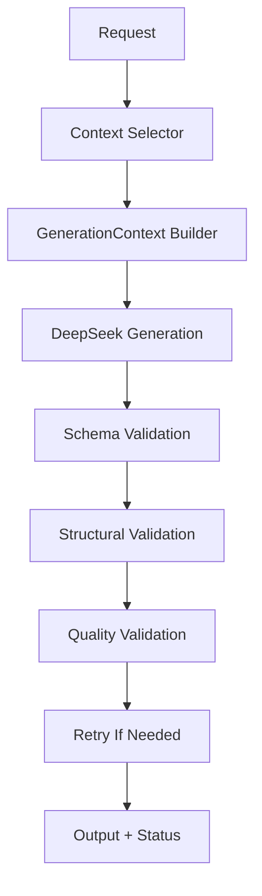

# Wanderly Explore Content Pipeline V3.4 Summary

## 1. 文档信息

- 项目：Wanderly Explore Content Pipeline
- 当前版本：V3.4
- 当前状态：核心闭环基本完成
- 适用城市：当前以北京为主
- 当前内容生产范围：北京精品样板

本文件是 V3.4 的正式总结文档。

它的目标不是列一份开发日志，而是说明：

- 当前内容生产链路为什么这样设计
- 各模块分别解决了什么问题
- 当前系统已经能稳定做到什么
- 当前还不能宣称做到什么
- V3.5 应该从哪里继续接手

本文件只以当前仓库中的实际代码、文档和输出结果为准。

## 2. V3.4 的目标

V3.4 的目标不是单纯提高 prompt 文采，也不是为了马上批量生成更多文章。

V3.4 的核心目标，是把系统从“模型写作脚本”升级成“可控制、可验证、可重试的内容生产流水线”。

重点包括：

- 可根据请求选择不同上下文
- 可注入城市策略与地图事实
- 可验证输出格式
- 可验证行程结构
- 可检查内容质量
- 可在失败后自动重试
- 可记录最终生成状态

换句话说，V3.4 要解决的不是“模型能不能写”，而是“系统能不能稳定地产出更可信的精品计划”。

## 3. 当前 Pipeline 架构

当前 V3.4 的核心流程可以总结为：



这条链路对应的实际含义是：

- `Request`：具体旅行内容生成请求
- `Context Selector`：决定应该选择哪些城市知识、区域、路线主题和生成约束
- `GenerationContext Builder`：把选择结果整理成模型可稳定使用的结构化上下文
- `DeepSeek Generation`：基于 `GenerationContext` 生成 Explore plan JSON
- `Schema Validation`：检查字段形状和类型
- `Structural Validation`：检查天数、day 编号、引用关系等结构问题
- `Quality Validation`：检查 traveler 语境、地图负担、food reason 质量和 context 偏离
- `Retry`：失败时要求模型完整重写 JSON
- `Output + Status`：保存结果并记录验证状态

## 4. 各环节职责、输入输出与当前限制

### 4.1 Request

输入：

- 城市
- traveler_type
- days
- season
- budget
- pace
- motivation
- theme

输出：

- 标准化后的请求信息

主要职责：

- 表达这次到底要生成什么类型的路线

解决的问题：

- 让后续环节围绕明确请求工作，而不是泛化成“写一篇北京攻略”

当前限制：

- 目前主要验证的是北京三类组合

### 4.2 Context Selector

对应实现：

- [selectContext.ts](/C:/Users/10200/Desktop/travel-content-pipeline/src/context/selectContext.ts)
- [context_selection_strategy_v1.md](/C:/Users/10200/Desktop/travel-content-pipeline/docs/context_selection_strategy_v1.md)

输入：

- 标准化请求

输出：

- `selected_content_context`
- `selected_city_strategy_context`
- `selected_generation_guidance`
- `selected_map_context`
- `selected_quality_context`

主要职责：

- 决定“选什么”

具体包括：

- 选哪些区域
- 选哪些 POI
- 选哪些食物主题
- 选哪些 traveler 语境
- 选哪些地图约束
- 选哪些质量要求

解决的问题：

- 城市知识库不再整体直接塞进 prompt
- 同一份北京知识可以生成不同 traveler / motivation / theme 的不同上下文

当前限制：

- 当前只支持 `beijing`
- 非北京请求会明确抛错：`Only beijing is supported by Context Selector V1.`
- 当前仍偏规则映射与手写候选，不是完整 scoring 系统

### 4.3 GenerationContext Builder

对应实现：

- [buildGenerationContext.ts](/C:/Users/10200/Desktop/travel-content-pipeline/src/context/buildGenerationContext.ts)
- [types.ts](/C:/Users/10200/Desktop/travel-content-pipeline/src/context/types.ts)
- [generation_context_object_v1.md](/C:/Users/10200/Desktop/travel-content-pipeline/docs/generation_context_object_v1.md)

输入：

- `Context Selector` 的选择结果

输出：

- `GenerationContext`

当前实际结构为：

```text
request_context
content_context
city_strategy_context
generation_guidance
map_context
quality_context
```

主要职责：

- 决定“如何把已选内容组织成模型可用的上下文”

解决的问题：

- 城市知识库不再全文直接灌入模型
- 先由 Selector 筛选，再由 Builder 组织
- 同一份北京知识库可以针对 couple、student、solo 形成不同上下文

当前限制：

- 仍然以北京为主
- 还没有独立 Builder 配置系统或通用注册机制

## 5. Context Selector 与 GenerationContext 的区别

这是当前 V3.4 中最重要的架构区分之一。

### Context Selector

负责决定：

```text
选什么
```

例如：

- 选哪些区域
- 选哪些 POI
- 选哪些 food knowledge
- 选哪些 map facts
- 选哪些 quality rules

### GenerationContext Builder

负责决定：

```text
如何把已选内容组织成模型可用的上下文
```

也就是说：

- Selector 先根据请求做筛选
- Builder 再把筛选后的内容组装成稳定结构

这让系统从“直接把资料喂给模型”变成了“先做上下文决策，再做生成”。

## 6. 北京城市策略如何进入生成流程

相关文档：

- [city_content_strategy_beijing_v1.md](/C:/Users/10200/Desktop/travel-content-pipeline/docs/city_content_strategy_beijing_v1.md)
- [explore_content_matrix_v1.md](/C:/Users/10200/Desktop/travel-content-pipeline/docs/explore_content_matrix_v1.md)
- [content_quality_rules_v3_3.md](/C:/Users/10200/Desktop/travel-content-pipeline/docs/content_quality_rules_v3_3.md)

当前北京策略的核心不是“列景点”，而是：

- 强调皇城尺度
- 强调胡同与街区纹理
- 强调食物记忆
- 强调新旧对比
- 强调不同 traveler 的体验差异
- 优先做少量精品路线
- 不追求快速堆量

这套策略目前不是直接作为一整份文档塞进 prompt。

它的实际进入方式是：

1. 由 `Context Selector` 按 traveler / motivation / theme 选择内容
2. 由 `GenerationContext` 将这些内容组织进：
   - `content_context`
   - `city_strategy_context`
   - `generation_guidance`
   - `quality_context`
3. 再交给 DeepSeek 生成 plan

因此，北京策略已经不是“文档存在仓库里”，而是已经成为当前实验生成链路的输入组成部分。

## 7. 地图事实如何进入 map_context

相关文档：

- [map_api_integration_plan_v1.md](/C:/Users/10200/Desktop/travel-content-pipeline/docs/map_api_integration_plan_v1.md)
- [generation_context_map_data_v1.md](/C:/Users/10200/Desktop/travel-content-pipeline/docs/generation_context_map_data_v1.md)

当前已经有真实高德验证过的样例：

```text
故宫博物院
latitude: 39.917839
longitude: 116.397029
```

```text
什刹海
latitude: 39.940803
longitude: 116.387581
```

```text
故宫博物院 -> 什刹海
mode: walking
distance: 3852m
duration: 51min
source_provider: amap
```

当前 map_context 的作用是：

- 把地图事实转成生成约束
- 防止模型把高负担路线写成“轻松步行”
- 在 Quality Validation 中继续检查文案是否违背地图负担

当前必须明确区分：

- `source_provider: amap`
- `source_provider: selector_estimate`

目前：

- couple 版本包含真实高德验证过的 `故宫博物院 -> 什刹海`
- student 与 solo 的部分 map 数据仍是 `selector_estimate`

因此当前不能声称：

- student / solo 的全部 map facts 都已经真实接高德 API

## 8. 三类北京测试样本

当前 V3.4 的 selected context 生成测试，主要围绕三类北京样本展开。

实际输出文件为：

- [beijing_couple_first_visit_autumn_v34.json](/C:/Users/10200/Desktop/travel-content-pipeline/output/beijing_v34_selected_context_test/beijing_couple_first_visit_autumn_v34.json)
- [beijing_student_food_winter_v34.json](/C:/Users/10200/Desktop/travel-content-pipeline/output/beijing_v34_selected_context_test/beijing_student_food_winter_v34.json)
- [beijing_solo_revisit_spring_v34.json](/C:/Users/10200/Desktop/travel-content-pipeline/output/beijing_v34_selected_context_test/beijing_solo_revisit_spring_v34.json)

### 8.1 Couple

验证重点：

- 首次北京印象
- 皇城核心区
- 故宫或代表性地标
- 胡同与什刹海
- 黄昏过渡
- 晚餐收尾
- 情侣氛围
- 路线负担约束

### 8.2 Student

验证重点：

- 冬季北京美食
- 牛街或南城
- 早餐
- 铜锅涮肉或暖胃主餐
- 低预算
- 高性价比
- 不混入 solo 语境

### 8.3 Solo

验证重点：

- 北京街区纹理
- 慢行
- 自由停顿
- 咖啡馆、书店或看展
- 一个人的路线节奏
- 不出现情侣化收尾

这三类样本的意义，不是“生成了三篇文章”，而是证明：

- 不同上下文确实会驱动不同路线
- traveler 语境可以被系统约束
- map facts 可以进入生成控制
- retry 与 validation 可以拦截明显错误

## 9. 三层 Validation 为什么必须存在

当前系统已经证明，仅有 schema validation 不够。

### 9.1 Schema validation

对应实现：

- [schema.ts](/C:/Users/10200/Desktop/travel-content-pipeline/src/schema.ts)

负责检查：

- 字段是否存在
- 字段类型是否正确
- JSON 是否符合 Explore plan schema

它解决的是：

```text
格式是否合法
```

它不能解决的是：

```text
内容是否可用
```

### 9.2 Structural validation

对应实现：

- [validatePlanStructure.ts](/C:/Users/10200/Desktop/travel-content-pipeline/src/validation/validatePlanStructure.ts)

负责检查：

- `daily_itinerary.length === plan.days`
- day 编号是否唯一
- day 编号是否连续
- day title 是否重复
- day summary 是否重复
- activities 是否为空
- `poi_refs` 是否引用真实 POI
- `food_refs` 是否引用真实 food

它解决的是：

```text
结构是否可正常使用
```

V3.4 已经实际遇到过的问题包括：

- day 1 重复
- 行程片段重复
- schema 虽通过但日程结构不可用

因此：

```text
schema valid ≠ structurally usable
```

### 9.3 Quality validation

对应实现：

- [validatePlanQuality.ts](/C:/Users/10200/Desktop/travel-content-pipeline/src/validation/validatePlanQuality.ts)

负责检查：

- 模板化表达 warning
- traveler 语境
- couple / student / solo 的核心约束
- 地图负担与文案冲突
- `food.reason` 是否过短或过弱
- food 是否体现对应 traveler 的价值

它解决的是：

```text
内容是否真的符合当前生成任务和上下文
```

因此：

```text
schema valid ≠ content usable
```

## 10. Retry Logic

当前实际 retry 逻辑集中在：

- [testGenerateSelectedContexts.ts](/C:/Users/10200/Desktop/travel-content-pipeline/src/testGenerateSelectedContexts.ts)

当前策略是：

### 10.1 Schema 失败

- 触发 schema retry
- 要求模型完整重写 JSON
- 明确继续遵守当前 context
- 明确约束 time_block 等结构性枚举

### 10.2 Structure 失败

- 触发 structural retry
- 要求模型完整重写 JSON
- 明确修正 day 数量、day 编号、title / summary 重复、refs 存在性

### 10.3 Quality 失败

- 触发 quality retry
- 要求模型完整重写 JSON
- 列出 `quality_errors`
- 尽量减少 `quality_warnings`
- 继续遵守 current GenerationContext

### 10.4 为什么当前采用“完整重写”而不是局部修补

原因包括：

- 局部修补容易破坏 POI / food 引用关系
- 局部修补可能让 day、POI、food 之间失去一致性
- 当前阶段生成的是整份 JSON 路线，不是增量编辑器
- 完整重写更适合当前模型生成特性

当前代码会记录：

- `retry_used`

但当前并没有实现一个复杂的多轮 retry 策略配置中心，因此不应虚构不存在的 retry 上限或策略层。

## 11. 输出状态与追踪字段

根据当前 `src/testGenerateSelectedContexts.ts` 的实际输出，当前会记录以下状态：

```text
schema_valid
structural_valid
quality_valid
respects_core_constraints
retry_used
structural_errors
quality_errors
quality_warnings
formal_generation_flow_changed
```

这些状态的作用是：

- 判断输出是否可进入人工审查
- 观察不同 traveler 的生成稳定性
- 记录 retry 使用情况
- 为后续批量生产与回归测试提供基础

其中：

- `schema_valid`：字段形状是否通过
- `structural_valid`：行程结构是否可用
- `quality_valid`：内容是否遵守当前 context
- `respects_core_constraints`：是否满足当前 traveler / context 的关键要求
- `retry_used`：这次生成是否触发过重试

## 12. V3.4 已解决的问题

截至当前版本，V3.4 已实际解决的问题包括：

- 城市知识不再全部直接塞进 prompt
- 不同 traveler 可以得到不同上下文
- student 不再混入 solo 语境
- solo 不再混入情侣式收尾
- map_context 会随 Selector 分化
- schema 无法发现的重复 day 问题可被结构校验拦截
- 路线负担与文案冲突可被质量校验发现
- 失败结果具有明确 retry 路径
- 最终结果具有可追踪的检查状态

这些都是当前仓库中已经实际存在的功能或实验流程，不是未来计划。

## 13. 当前限制

当前仍然必须诚实承认以下限制：

- student 和 solo 仍有部分 `selector_estimate`
- Context Selector V1 仍偏手写规则
- 还没有形成完整的 rule + scoring 系统
- Quality validation 主要依赖关键词与规则
- 可能存在误判或漏判
- 尚未接入正式批量生成流程
- 图片 prompt 尚未系统化
- 北京精品样板尚未冻结
- 尚未扩展到上海和成都
- 当前不能证明系统适合直接生成 1000 篇内容

## 14. 为什么现在不应该直接扩展到 1000 篇

从工程和内容质量角度看，当前不应直接进入 1000 篇生成阶段。

原因包括：

- 小规模缺陷会在批量生产中被放大
- 地图估算可能形成事实风险
- 模板表达会被大量复制
- traveler 语境污染会影响整批内容
- 没有精品样板时缺乏评估基准
- 当前更需要先稳定生成闭环
- 数量增长不等于内容系统成熟

因此当前必须明确：

```text
V3.4 的价值是证明闭环可行，而不是证明系统已经适合大规模生产。
```

## 15. V3.5 建议方向

### Priority A：真实地图数据审计与补全

- 审计 student 和 solo 当前使用的地图地点
- 用高德 API 补真实坐标
- 补真实距离与预计时间
- 减少 `selector_estimate`
- 保留明确数据来源字段
- 区分 API 结果与 fallback 估算

### Priority B：北京精品样板冻结

- 对 couple / student / solo 三份结果做人工审查
- 检查路线合理性
- 检查 food 选择
- 检查 traveler 语境
- 做轻微修文
- 固化为北京精品基准样板

### Priority C：Selector V2

- 从手写映射逐步升级为 rule + scoring
- 保留可解释性
- 不要在当前阶段过早引入复杂算法
- 先支持北京核心类型的稳定选择

### 当前不建议优先做的事

- 暂不直接批量生成 1000 篇
- 暂不优先扩展上海或成都
- 暂不优先重构复杂图片生产
- 暂不大幅重写当前正式生成流程

## 16. V3.4 完成状态 Checklist

- [x] 北京城市知识和内容策略已建立
- [x] GenerationContext 已实现
- [x] Context Selector V1 已实现
- [x] Couple / Student / Solo 三类上下文可生成
- [x] 三类北京测试样本已生成
- [x] Schema validation 已接入
- [x] Structural validation 已接入
- [x] Quality validation 已接入
- [x] Retry 已接入
- [x] 输出检查状态可追踪
- [ ] Student / Solo 真实地图数据补全
- [ ] 北京精品样板冻结
- [ ] Selector V2 rule + scoring
- [ ] 正式批量生成流程

## 17. Success Standard

V3.4 的成功标准不是“系统能生成计划”。

真正的成功标准是：

- 能选择不同上下文
- 能生成不同路线
- 能检查结构错误
- 能检查内容偏离
- 必要时自动 retry
- 保持正式生成流程不受影响

换句话说，V3.4 已经把系统推进到了一个新的阶段：

它不再只是“会吐 JSON 的模型调用”。

它已经开始具备“稳定精品内容生产链路”的基本闭环。
