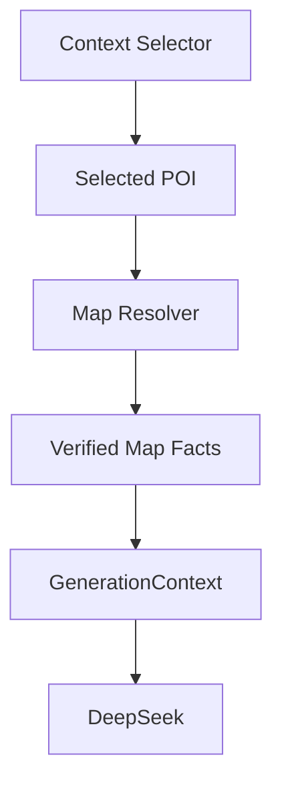

# V3.5 Step1-D1 GenerationContext 与 Map Resolver 接入设计

## 1. 当前状态

截至 V3.5 Step1-D1，地图事实层已经具备独立基础能力：

- Map Asset
- Repository
- Resolver

已经存在的链路是：

```text
AMap API
  ↓
Map Assets JSON
  ↓
Repository
  ↓
Map Resolver
```

已经具备的模块包括：

- `src/map/types.ts`
- `src/map/amapClient.ts`
- `src/map/repository/mapAssetRepository.ts`
- `src/map/resolver/mapResolver.ts`
- `input/maps_v1/beijing/poi_assets.json`
- `input/maps_v1/beijing/route_facts.json`

但当前仍缺少一层关键接入：

```text
Map Resolver
  ↓
GenerationContext
```

也就是说，地图资产和地图事实现在已经能被独立查询，但还没有进入生成前的统一上下文对象。

---

## 2. 当前 `map_context` 分析

### 2.1 当前字段结构

当前 `src/context/types.ts` 中的 `map_context` 结构为：

- `verified_pois`
- `route_facts`
- `transfer_burden`
- `cluster_warnings`
- `route_feasibility_notes`

其中字段语义已经比较接近未来目标：

- `verified_pois` 负责 POI 层事实
- `route_facts` 负责距离与时间事实
- `transfer_burden` 负责旅行负担解释
- `cluster_warnings` 负责聚类或跨区风险提醒
- `route_feasibility_notes` 负责可行性说明

### 2.2 当前来源

当前 `buildGenerationContext.ts` 并不主动读取 Map Asset，也不调用 Map Resolver。

当前来源实际上是：

```text
buildGenerationContext
  ↓
selectContext
  ↓
selected_map_context
```

也就是说，`map_context` 当前仍直接来自 `Context Selector`。

### 2.3 当前用途

当前用途主要有三个：

- 约束模型不要随意发明轻松步行
- 为特定 traveler 提供移动负担提醒
- 为 quality validation 提供一部分地图相关约束基础

### 2.4 当前问题与限制

当前 `map_context` 虽然可用，但有明显限制：

- 事实来源和内容选择仍然耦合
- `selector_estimate` 与 `amap` 混在同一个上下文层里
- `buildGenerationContext` 不知道哪些 route 是 JSON verified facts，哪些只是过渡估算
- `Context Selector` 仍在承担一部分本应由 Map Resolver 承担的地图职责

因此，当前 `map_context` 的核心问题不是“字段不够”，而是“事实来源边界不够清楚”。

---

## 3. 推荐未来架构

建议未来接入路径如下：



这条路径强调三件事：

- `Context Selector` 只负责选择地点，不负责计算距离
- `Map Resolver` 只负责从资产层返回真实地图事实
- `GenerationContext` 只接收整理后的事实，不直接读 JSON，也不自己推断距离

这样做之后，模型看到的地图信息将不再是“selector 内部拼出来的地图片段”，而是“Resolver 返回的可追溯事实集合”。

---

## 4. GenerationContext 新地图结构设计

### 4.1 设计原则

未来 GenerationContext 中的地图部分需要满足三个原则：

- 不让模型直接读取 JSON
- 不让 selector 计算距离和时长
- 不让 prompt 硬编码路线事实

因此建议继续保留 `map_context` 这个中间层，但把它的事实来源改为 Resolver 输出。

### 4.2 推荐结构

建议未来 `map_context` 在语义上拆成两组核心输入：

- `verified_pois`
- `verified_routes`

可参考结构如下：

```json
{
  "verified_pois": [
    {
      "name": "故宫博物院",
      "latitude": 39.917839,
      "longitude": 116.397029,
      "source_provider": "amap",
      "confidence": "verified"
    }
  ],
  "verified_routes": [
    {
      "from": "故宫博物院",
      "to": "景山公园",
      "mode": "walking",
      "distance_m": 1445,
      "duration_min": 19,
      "source_provider": "amap",
      "confidence": "verified"
    }
  ]
}
```

### 4.3 与当前结构的关系

当前 `map_context` 并不一定需要大改，而是可以做“语义升级”：

- 当前 `verified_pois` 可以继续保留
- 当前 `route_facts` 可以在 D2 过渡为“verified routes 优先”的 route facts
- 当前 `transfer_burden`、`cluster_warnings`、`route_feasibility_notes` 仍保留，因为它们属于生成解释层

因此更合适的方向不是推翻现有结构，而是调整其来源和优先级。

### 4.4 推荐事实分层

未来 `map_context` 中建议存在两类内容：

#### A. Hard Facts

- `verified_pois`
- `verified_routes`

这些来自：

- Map Asset
- Repository
- Map Resolver

#### B. Derived Guidance

- `transfer_burden`
- `cluster_warnings`
- `route_feasibility_notes`

这些可以由 future builder 或 Resolver 附加逻辑生成，但前提必须是基于 verified facts，而不是空推测。

---

## 5. `selector_estimate` 迁移方案

`selector_estimate` 当前不应立即删除，因为它仍承担着 coverage 补位作用。

更合理的迁移方式应分三阶段进行。

### Phase 1

verified route 优先。

规则：

- 如果某条 route 已存在 `amap verified` 事实，则优先进入 `map_context`
- 同一条 route 不再使用 `selector_estimate`
- `selector_estimate` 只保留在未覆盖段

这一阶段的目标不是“全量替换”，而是先建立优先级规则。

### Phase 2

未覆盖路线继续使用 estimate。

规则：

- 北京核心样本中已被资产覆盖的 route 走 verified
- 尚未被资产覆盖的片段继续使用 `selector_estimate`
- 在 `map_context` 中明确区分 verified 与 estimated 来源

这一阶段的目标是“允许混合，但不允许混淆”。

### Phase 3

北京核心路线全部 verified。

规则：

- 三类北京样本中的核心路线段逐步完成 verified 替换
- `selector_estimate` 退出北京核心样本主路径
- estimate 只保留给未采集城市或边缘片段

这一阶段完成后，北京将成为首个“核心线路 verified 优先”的样板城市。

---

## 6. Step1-D2 实施计划

下一步建议进入小范围接入，而不是一次性大改。

### 6.1 修改范围

只规划，不在本步实现：

- `src/context/buildGenerationContext.ts`
- `src/context/types.ts`

### 6.2 接入方式

建议 D2 只做最小接入：

1. `buildGenerationContext` 在北京样本路径下调用 Map Resolver
2. 根据 selected POI 和 selected route 查询 verified facts
3. 将查询结果整理成新的 `map_context`
4. 已命中的 verified routes 覆盖同路径下的 `selector_estimate`

### 6.3 接入范围

范围必须严格收缩：

- 只北京
- 只三个样本
- 只第一批 verified route

不要：

- 扩城市
- 扩批量生成
- 一次性替换全部 estimate

### 6.4 D2 验证目标

D2 完成后重点验证：

- `map_context` 是否能稳定承载 verified facts
- verified route 是否成功替换对应 `selector_estimate`
- 三类北京样本的路线文案是否更贴近真实移动负担

---

## 7. 结论

当前最重要的结论是：

- Map Resolver 已具备事实查询能力
- GenerationContext 已具备地图承载位置
- 两者之间真正缺少的不是字段，而是接入边界和来源优先级

因此 V3.5 Step1-D1 的设计重点不是重新发明 `map_context`，而是明确：

- `Context Selector` 继续负责选地点
- `Map Resolver` 开始负责提供 verified map facts
- `GenerationContext` 成为 verified facts 的统一承载层
- `selector_estimate` 按阶段退出北京核心路径

这意味着下一步最合适的工作不是继续做新架构设计，而是进入小范围接入验证。
