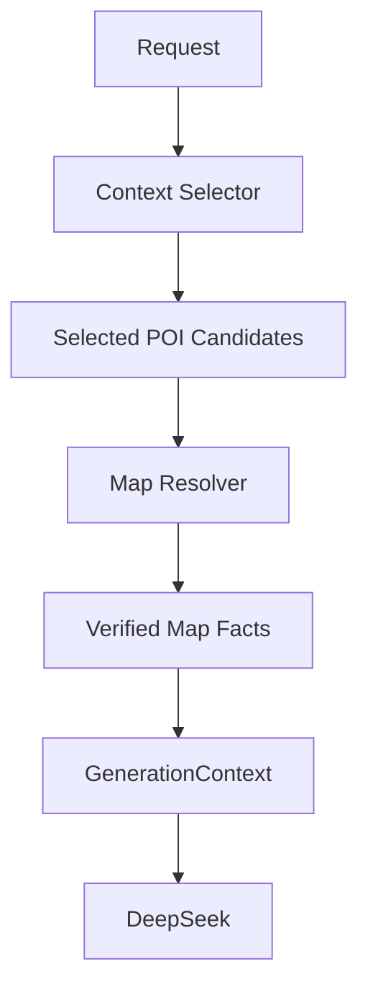

# V3.5 Step1-B1 Map Resolver 架构设计

## 1. 当前架构问题

当前 V3.4 / V3.5 Step1-A 之后的实际形态，仍然是:

```text
Request
  ↓
Context Selector
  ↓
GenerationContext
  ↓
DeepSeek
```

这条链路在内容生成上已经可用，但在地图真实性上有三个结构性问题。

### 1.1 内容选择与地图验证被混在一起

`Context Selector` 当前既负责:

- traveler / motivation / theme / season 的内容选择
- 片区与 POI 候选筛选
- 部分地图估算，例如 `selector_estimate`

这会导致一个模块同时处理“写什么”和“这些地点是否真实、彼此是否顺路”两类完全不同的问题。

但这两类问题本质不同:

- 内容选择回答的是“为什么去”
- 地图验证回答的是“能不能去、怎么去、负担多大”

### 1.2 `selector_estimate` 不能长期承担路线事实职责

`selector_estimate` 在 V3.4 阶段有价值，因为它让 student / solo 样本先跑通了 context-based generation。

但它只适合作为过渡层:

- 可以帮助系统先描述大致跨区关系
- 不适合长期承担真实距离、真实时间、真实可达性判断
- 不应被误用为“已经验证过的路线事实”

如果未来继续扩城市或扩批量生成，而不把这层拆出去，路线可信度会越来越不稳定。

### 1.3 GenerationContext 不应该直接接收“内容估算版地图”

`GenerationContext` 的职责是把模型真正需要遵守的事实、策略和约束整理好。

因此它更适合接收:

- 已整理的 verified / estimated map facts
- 已明确置信度的 route facts
- 已判定好的 transfer burden

而不应该直接承接 Selector 内部临时拼装的半地图、半内容估算结果。

---

## 2. 推荐未来架构

建议将“内容选择”和“地图验证”拆成两个独立阶段。



这个结构的核心不是多加一个模块，而是明确一条边界:

- `Context Selector` 负责选择“候选内容”
- `Map Resolver` 负责把候选内容变成“可约束模型的地图事实”
- `GenerationContext` 只接收已经整理好的事实层结果

这样做之后，系统中的地图真实性就不再依赖内容模块的手写估算。

---

## 3. 模块职责划分

### 3.1 Context Selector

负责:

- traveler_type
- motivation
- theme
- season
- budget
- pace
- days
- 城市区域选择
- 推荐 POI 候选
- 推荐 food / scene 候选
- generation guidance 的内容选择

不负责:

- 精确距离
- 精确时间
- 路线负担判断
- 坐标补全
- 路径可达性验证

Selector 的输出应该是“哪些地点值得进入路线候选”，而不是“这些地点已经被地图验证”。

### 3.2 Map Resolver

负责:

- POI 识别
- 坐标补全
- route 查询
- distance
- duration
- transport mode 对应的移动事实
- transfer burden 判断
- verified / estimated / partial 的置信度标记

Map Resolver 的本质是“地图事实整理器”，而不是内容生成器。

### 3.3 GenerationContext

负责:

- 接收最终地图事实
- 接收内容策略和质量规则
- 把 map facts 与内容 guidance 一起整理成模型输入

不负责:

- 再次做 POI 识别
- 重新猜测距离与时间
- 自己判断某段路是否轻松

它只消费事实，不生产地图事实。

---

## 4. 数据层设计

建议把未来地图相关数据拆成三层，避免“内容描述”和“地理事实”继续混写。

### 4.1 Content Knowledge Layer

回答:

```text
为什么去
```

这一层包含:

- 城市气质
- 片区价值
- 主题适配
- traveler 适配
- food / memory / atmosphere 的编辑判断

例子:

- 故宫适合做首次北京印象的主锚点
- 牛街适合做冬季学生路线的暖胃主轴
- 鼓楼到南锣更适合 solo 的街区观察

这一层是内容判断，不是地图真值。

### 4.2 POI Identity Layer

回答:

```text
去了哪里
```

这一层包含:

- 标准化 POI 名称
- 唯一标识
- 行政区
- 坐标
- provider 返回的可识别实体
- source_provider
- confidence

它解决的是“这个地点到底是不是一个真实可识别的地点”。

### 4.3 Route Fact Layer

回答:

```text
如何移动
```

这一层包含:

- from / to
- mode
- distance
- duration
- transfer burden
- cluster warnings
- route feasibility notes

它解决的是“这些地点之间怎么连，以及连起来的代价是否合理”。

### 4.4 三层之间的区别

三层不能混写:

- Content Knowledge Layer 决定“这条路线值不值得这样写”
- POI Identity Layer 决定“这些地点是否真实存在、叫什么、在哪里”
- Route Fact Layer 决定“它们之间如何移动、是否顺路、是否过重”

只有把这三层拆开，后续接更多地图 API、POI API、餐厅 API 时才不会反复返工。

---

## 5. Map Asset 类型设计

不是所有地点都需要在第一时间进入高德验证层。为了控制成本和复杂度，建议先区分两类地图资产。

### 5.1 Anchor POI

这类地点必须真实验证。

典型例子:

- 故宫
- 天坛
- 798
- 牛街
- 鼓楼
- 景山
- 什刹海
- 前门
- 南锣

Anchor POI 的特点:

- 会决定整天或整段路线结构
- 会影响跨区移动判断
- 会影响模型是否误写“顺路”“轻松步行”“适合当天下午临时插入”

因此这类点必须优先完成坐标、真实 POI 识别和关键 route facts。

### 5.2 Experience POI

这类地点可以后补，或者在早期保留更灵活的处理方式。

典型例子:

- 咖啡馆
- 小书店
- 小餐馆
- 某条侧巷里的临时停顿点
- 某个展馆附近的简餐点

Experience POI 的特点:

- 更偏体验补充，而不是路线骨架
- 更容易变化
- 更适合在 content layer 先保留弹性

### 5.3 为什么不能所有地点都立即进入高德验证

原因不是“不能做”，而是“没有必要一开始就全部做”。

- 核心路线真实性主要由 Anchor POI 和关键跨区段决定
- Experience POI 数量多、变化快、维护成本高
- 如果一开始就要求每个咖啡馆和小餐馆都进入验证层，会大幅拖慢系统建设

因此更合理的顺序是:

1. 先验证 Anchor POI
2. 再补关键 route segments
3. 最后按需要补 Experience POI

---

## 6. Route Fact Schema

未来建议统一使用如下结构表达 route facts:

```json
{
  "id": "",
  "from": "",
  "to": "",
  "mode": "",
  "distance_m": "",
  "duration_min": "",
  "source_provider": "",
  "confidence": ""
}
```

### 6.1 字段说明

- `id`
  - route fact 的稳定标识，便于缓存、复用和去重
- `from`
  - 起点标准名称
- `to`
  - 终点标准名称
- `mode`
  - walking / transit / driving / cycling 等
- `distance_m`
  - 路段距离，单位米
- `duration_min`
  - 路段时长，单位分钟
- `source_provider`
  - 路段事实来源
- `confidence`
  - 当前事实置信等级

### 6.2 `source_provider`

建议支持:

- `amap`
- `selector_estimate`
- `future providers`

其中:

- `amap` 表示来自高德地图开放平台
- `selector_estimate` 表示仍处于内容层估算
- `future providers` 为后续扩展其他地图或路线数据源预留

### 6.3 `confidence`

建议支持:

- `verified`
- `estimated`
- `partial`

含义:

- `verified`
  - 已有真实 provider 支撑，可用于强约束模型
- `estimated`
  - 当前只是规则估算，不应用于精确表达
- `partial`
  - 已有部分真实信息，但仍不完整，例如 POI 已真实识别，route 仍未完整验证

这两个字段组合起来，可以帮助 GenerationContext 和后续 validation 更清楚地区分“硬事实”和“过渡事实”。

---

## 7. V3.5 Step1-B2 实施建议

本节只写建议，不涉及任何正式代码修改。

### 7.1 第一批补全的 Anchor POI

建议优先补全以下地点的真实地图身份与坐标:

- 故宫
- 景山
- 什刹海
- 前门
- 牛街
- 鼓楼
- 南锣
- 798
- 天坛

### 7.2 第一批补全的 Route Facts

建议优先补全以下关键移动段:

- 故宫 → 景山
- 景山 → 什刹海
- 牛街 → 前门
- 牛街 → 鼓楼
- 鼓楼 → 南锣
- 鼓楼 → 798

### 7.3 为什么先补这一批

因为它们同时满足三个条件:

- 已经出现在当前北京样板里
- 会实质影响路线负担判断
- 会决定 couple / student / solo 三类样板是否可信

换句话说，这不是“地图数据越多越好”，而是“先补最能改变生成质量的那一层”。

---

## 8. 核心结论

Map Resolver 的价值，不是把当前流程再加长一段，而是明确一条系统边界:

- Selector 负责“选什么”
- Map Resolver 负责“这些地点和移动事实是否真实”
- GenerationContext 负责“把已经整理好的事实交给模型”

如果这条边界不拆开，`selector_estimate` 就会持续处在一个尴尬位置:

- 它比纯文案更像事实
- 但又不足以作为真正的路线真值

因此，V3.5 Step1-B1 的设计结论是:

- `Context Selector` 不应长期承担地图估算职责
- `Map Resolver` 应成为独立模块
- `GenerationContext` 应只消费整理后的 verified map facts
- 北京样板的下一步重点不是扩更多内容，而是补齐最关键的真实地图骨架

