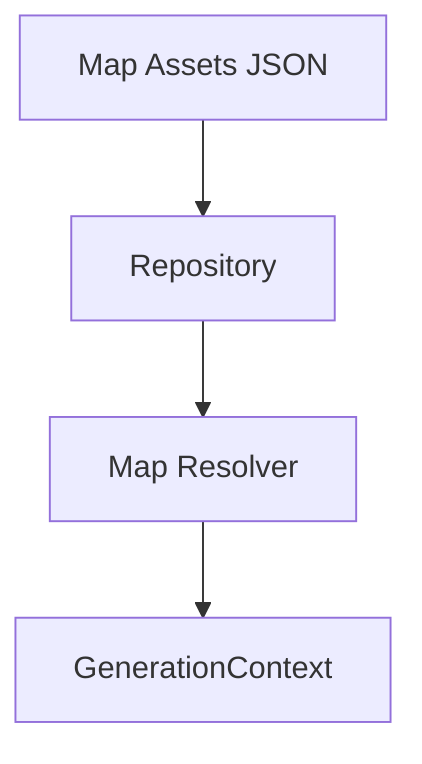

# V3.5 Step1-C Map Asset 与 Map Resolver 初步连接设计

## 1. 当前状态

截至当前阶段，地图能力已经具备三个基础部分：

- Map Asset JSON
- Map Asset 自动 QA
- AMap Client

已经具备的输入层包括：

- `input/maps_v1/beijing/poi_assets.json`
- `input/maps_v1/beijing/route_facts.json`

已经具备的基础代码包括：

- `src/map/types.ts`
- `src/map/amapClient.ts`
- `src/map/scripts/seedBeijingMapAssets.ts`
- `src/map/scripts/validateBeijingMapAssets.ts`

但当前仍缺少两层关键连接结构：

- 查询层
- Resolver 层

也就是说，地图资产虽然已经存在，但还没有形成一个稳定的“只读查询接口”，可供未来 GenerationContext 安全消费。

## 2. 架构图



这里的关键边界是：

- `Map Assets JSON` 是资产来源
- `Repository` 负责读取和索引
- `Map Resolver` 负责对外提供地图事实查询接口
- `GenerationContext` 在未来只消费 Resolver 的结果，而不直接读 JSON

## 3. Repository 职责

当前新增的 Repository 层负责：

- 读取 `poi_assets.json`
- 读取 `route_facts.json`
- 按名称查询 POI
- 按 `from + to + mode` 查询 route fact
- 为后续扩展索引和缓存保留位置

不负责：

- AMap API 调用
- 路线生成
- AI 内容生成
- traveler / theme / season 判断

Repository 的定位是“资产读取与查询层”，而不是“路线推理层”。

## 4. Resolver 职责

当前新增的 Map Resolver 初版负责：

- `resolvePoi(name)`
- `resolveRoute(from, to, mode)`

它的职责非常克制：

- 向上游暴露可用地图事实
- 向下游依赖 Repository

不负责：

- 内容推荐
- traveler 判断
- generation guidance 选择
- 调用高德补数

换句话说，Resolver 当前只是一个“地图事实查询门面”，不是完整地图规划器。

## 5. 与现有系统关系

当前阶段，Map Resolver 仍然是独立模块。

当前已经建立的是：

```text
Map Asset
 ↓
Repository
 ↓
Map Resolver
```

但尚未进入：

```text
Map Resolver
 ↓
GenerationContext
```

这意味着：

- 现有 `Context Selector` 未改动
- 现有 `GenerationContext` 未改动
- DeepSeek 调用链路未改动
- 正式生成流程仍保持 V3.4 / V3.5 Step1 之前的结构

这种隔离是有意的，因为当前阶段的目标是先把地图查询层独立出来，而不是直接改写生产链路。

## 6. 当前连接方式

当前的最小连接方式是：

1. Map Asset 通过 seed pipeline 产出 JSON
2. Repository 从 JSON 读取 POI 和 Route Fact
3. Resolver 对外提供统一查询接口
4. 独立测试脚本验证：
   - 可以按名称找到故宫博物院
   - 可以按 `故宫博物院 -> 景山公园 -> walking` 找到 route fact

这一步的价值在于，它已经把未来接入 GenerationContext 时最危险的一层拆了出来：

- 不让模型直接读取 JSON
- 不让上层自己拼装距离和时间
- 不让 selector 再承担地图事实职责

## 7. Step1-D 建议

下一步建议进入：

```text
V3.5 Step1-D
Map Resolver 小范围接入 GenerationContext，并替换部分 selector_estimate
```

建议范围保持很小：

- 先只接入北京
- 先只替换已经有 verified route facts 的片段
- 先只替换一小部分 `selector_estimate`
- 重新生成三类北京样本做对照

这一步仍然不建议立即扩城市或批量生成，因为当前更重要的是验证：

- Map Resolver 的结果能否稳定进入 GenerationContext
- 替换后的路线表达是否更真实
- 质量校验是否会因此变得更稳定
